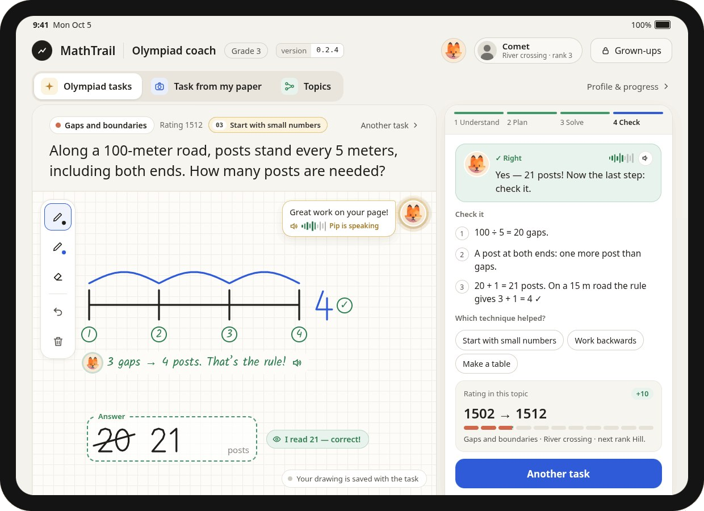

# MathTrail Canvas

MathTrail Canvas is a math tutor for children in grades 1–6. A child solves a task by hand, with a stylus or a finger, anywhere on a squared sheet and writes the final answer on the same sheet — there is no separate answer box. On **Send Answer**, one AI call reads the whole sheet: it finds the final answer, follows the reasoning and finds the first mistake. A program, not the AI, compares the answer with the task's key. When the answer is wrong, the tutor frames the place where the reasoning went wrong and asks one short guiding question. It never gives the answer.

The picture is a concept from the design: it shows where the product is heading, further than the MVP goes.

## Design

Where the design differs from the documents, the documents win.

- [The olympiad coach](https://mathtrail.app/en/coach/) — live on mathtrail.app.

## The MathTrail core

[mathtrail-standalone](https://github.com/MathTrail/mathtrail-standalone) is the core of MathTrail: a free, open-source app for Claude and ChatGPT that turns an adult's own chat into an olympiad maths trainer for grades 1–6, with checked tasks in any language, a diagnosis of the child's mistake and a memory of how they are progressing. Canvas takes its service skeleton, development environment, CI/CD and Terraform, but runs on its own: it shares neither tasks nor data with the core.

## Documents

The documents are in Russian.

- [docs/product.md](docs/product.md) — what we build and why: the scope of the MVP, scenarios, unit economics, metrics and acceptance criteria.
- [docs/spec.md](docs/spec.md) — how it is built: architecture, the sheet and the check images, the answer check, the draft analysis, the AI tutor, the API, data, security and deployment.
- [docs/privacy.md](docs/privacy.md) — children's data: what is collected and kept, what the external AI service receives, parental consent, deletion and retention.
- [docs/decisions.md](docs/decisions.md) — the decision log: what was decided, why, and what was rejected.
- [docs/self-hosting.md](docs/self-hosting.md) — how it is deployed: the one-time bootstrap, the delivery of every release, rollback and return.
- [docs/stack.html](docs/stack.html) — the technology stack, layer by layer, with versions and what is still to be chosen. Open the file from a checkout in a browser: GitHub shows only its source.
- [RUN.md](RUN.md) — the implementation plan, in epics: the current epic broken into small tasks, run and reviewed one at a time, and the later epics. The done epics, with their tasks, are archived in [docs/plan/](docs/plan/).
